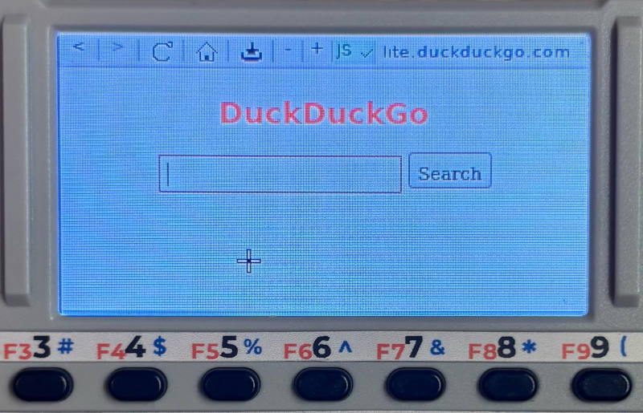

# Zero Browser

Browse websites, search the web and download files. Zero Browser is designed for the Cardputer Zero small screen and built-in keyboard. Choose [QtWebKit](https://github.com/qtwebkit/qtwebkit/releases) for general browsing with Javascript support, or [NetSurf](https://www.netsurf-browser.org/) for lightweight browsing on simpler websites.

>Zero Browser is experimental. Some websites may reject this unfamiliar browser or fail to load due to JavaScript incompatibilities. It should not be used for sensitive activities or anything requiring security. **Don't expect it to work like a regular browser capable of handling large, complex web applications**. This browser is based on old WebKit revision with known unpatched vulnerabilities. Please use it carefully and avoid visiting untrusted websites and using it for transmission of sensitive data.

Install it manually using the .deb package from the latest release, or find it directly on the Cardputer Zero Store.

## Why these two engines?

Due to the Cardputer Zero's hardware limitations, particularly its limited RAM, QtWebKit is the best compromise between performance, compatibility, and resource usage. While modern WPE WebKit offers better support for modern websites, its high memory consumption likely causes excessive swap usage, resulting in very long page loading times. QtWebKit typically loads pages in 5–10 seconds while maintaining reasonable website compatibility. NetSurf remains available as a faster, lightweight alternative for basic pages, despite its more limited HTML/CSS support.

| Engine | Strength | Limitation |
| --- | --- | --- |
| **QtWebKit 5.212** (default) | Richer HTML/CSS, JavaScript support | Old WebKit, some modern sites break or stall, higher memory use |
| **NetSurf GTK** | Very light engine, basic HTML/CSS | Not HTML5, JavaScript disabled |
| **Cog / WPE WebKit** (test only) | Latest WPE WebKit, compatible with modern JS | Too slow and memory hungry for the Zero |

The Cog implementation remains in the source for future experiments but is not shown in the selector or installed as a required dependency. To prevent excessive storage usage, cached data is limited to 256 MB per browser. Browsing history, cookies, and cache can also be cleared directly from the browser engine selection screen.

## JavaScript Support

JavaScript makes websites interactive, powering features such as dynamic content, menus, and modern web applications. However, it can also make pages heavier, slower, or incompatible with the Cardputer's memory limitation.

>**Note:** Zero Browser uses an outdated version of WebKit to accommodate the Cardputer Zero's hardware limitations. As a result, websites relying on modern JavaScript features may not display or function correctly, even with JavaScript enabled.

QtWebKit supports JavaScript but also allows you to disable it directly from the topbar. Switching JS on or off automatically reloads the current page.

Disabling JavaScript can sometimes improve browsing by reducing CPU and memory usage, loading a website's simpler non-JavaScript version when available, or bypassing JavaScript-based overlays that prevent access to page content.

## Memory and Stability

The Cardputer Zero has very limited memory, and some websites can quickly exhaust its resources. Zero Browser includes a watchdog that monitors QtWebKit's responsiveness and system memory pressure, automatically stopping the engine when a serious problem is detected.

This helps prevent system freezes, but it cannot guarantee protection against all type of crashes, memory exhaustion, or unexpected device reboots. Some websites may simply be too demanding for the hardware.

## Downloads

Both QtWebKit and NetSurf support file downloads. Downloaded files can be managed through a download manager, allowing you to monitor progress and manage transfers. Files are saved by default to `/home/your_user/Downloads`.

## Controls

| Keys | Action |
| --- | --- |
| **OK** | Select / left-click |
| **Shift + OK** | Right-click |
| **Fn + OK** | Send Enter to a web page |
| **F / Z / X / C** on a page | Move pointer (accelerates when held) |
| **Shift + F/Z/X/C** | Scroll without moving pointer |
| **Fn + F/Z/X/C** on a page | Type these letters |
| **Fn + W / E** | Back / forward |
| **Fn + R / T** | Zoom out / in |
| **Fn + L / M** | Page up / down |
| **Fn + K** | Open DuckDuckGo Lite |
| **ESC** | Dismiss overlays/menus as appropriate |
| **Hold ESC for 3 seconds** | Exit Zero Browser |

**In the address/search overlay**, F/Z/X/C type normally. **Fn + Z/C** moves the text caret left/right, **Tab** cycles history matches, **OK/Enter** submits.

## Limitations and safety

>
> Zero Browser uses outdated browser engines, including QtWebKit 5.212 and NetSurf, which may contain known or undiscovered security vulnerabilities. These engines do not provide the security protections expected from modern, actively maintained browsers.
>
> **Zero Browser is intended for experimental use only.** Do not use it to log in to websites, enter passwords, access sensitive accounts, perform financial transactions, or handle private information. Disabling JavaScript does not eliminate these security risks.